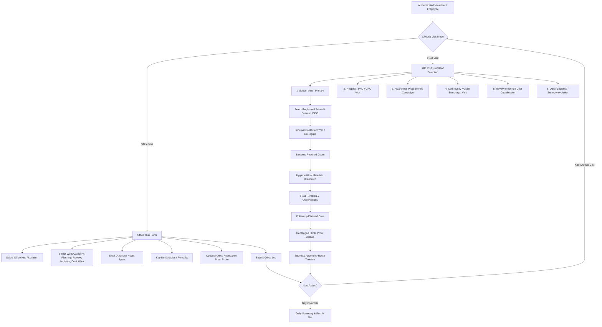
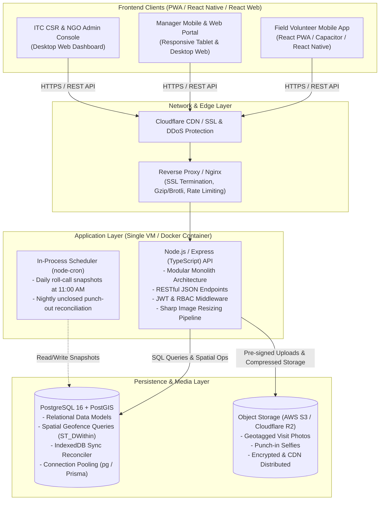
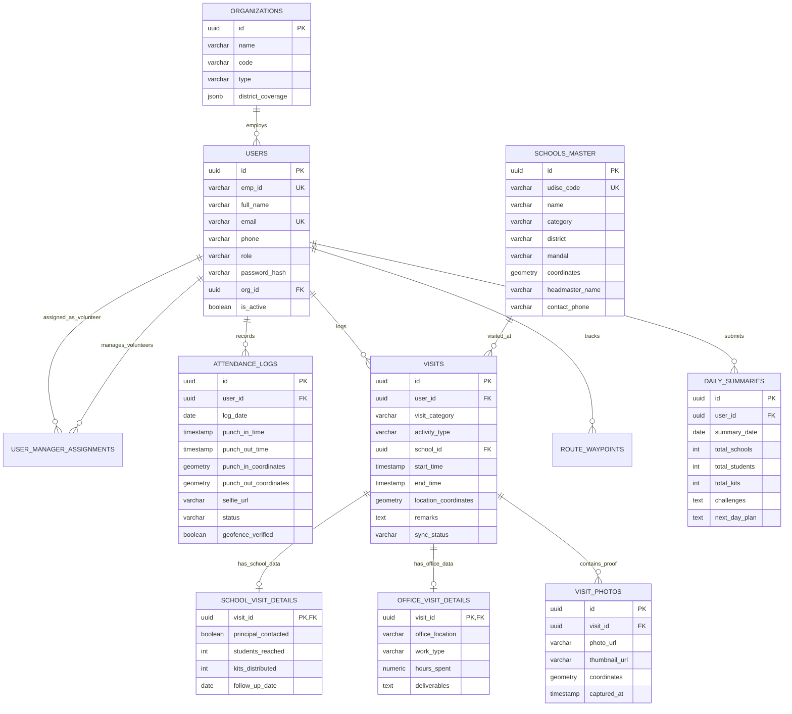
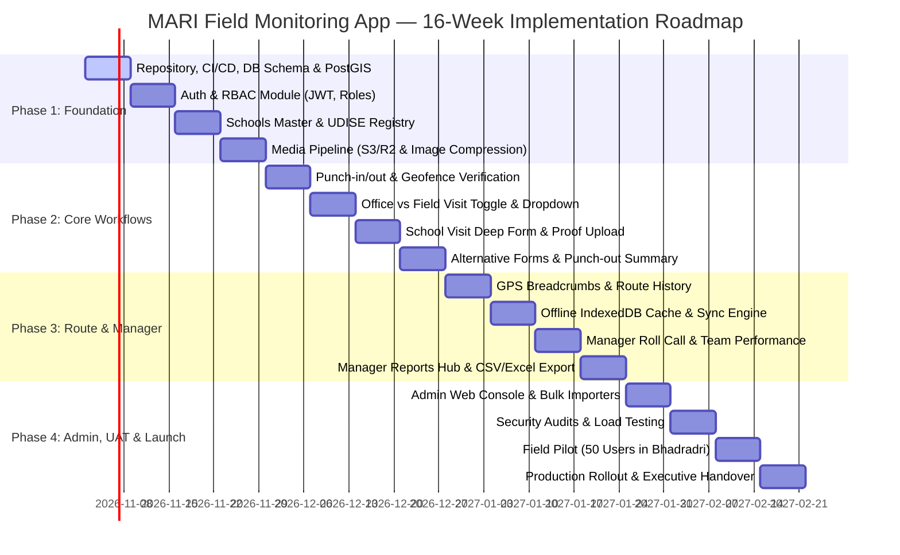

# MARI Field Monitoring Application — Engineering Implementation Plan & System Architecture

**Document Version:** 1.0.0  
**Target Audience:** Engineering Team, Project Managers, ITC CSR Leadership, NGO Directors  
**Target User Base:** 200 – 500 Active Users (Field Volunteers, Field Project Managers, NGO Admins, ITC Admins)  
**Timeline:** 12 – 16 Weeks to Full Production Deployment  

---

## 1. Executive Summary & Architectural Philosophy

The **MARI Field Monitoring Application** is a specialized enterprise field operations platform built for **ITC Mission Sunehra Kal** in partnership with **MARI (Modern Architect Rural India)** and allied partner NGOs. The platform tracks daily attendance, field/office activities, school health/hygiene interventions, route breadcrumbs, and daily summaries across rural districts (e.g., Bhadradri Kothagudem, Khammam, Warangal).

### 1.1 Core Engineering Principles

1. **Pragmatic, Lean, Production-Ready Architecture:**
   - Designed strictly for the actual operational scale of **200–500 active users**.
   - **No over-engineering:** Explicitly avoids distributed message brokers (Kafka, RabbitMQ, SQS) and distributed cache layers (Redis, Memcached) during Phase 1. 
   - A single modern Node.js/TypeScript or Python/FastAPI backend backed by **PostgreSQL 16 + PostGIS** handles 500 users with sub-50ms latencies while using under 15% CPU on a standard 4-vCPU VM.
2. **Modular Monolith Design:**
   - Domain-driven modular structure inside a single codebase.
   - Clean boundaries between Auth, Attendance, Visits, Media, and Reports. If user scale expands to 10,000+ users in future years, modules can be split into microservices without rewriting business logic.
3. **Offline-Resilient Field Experience:**
   - Field volunteers frequently operate in low-connectivity rural tribal mandals. The mobile client stores visit data in local SQLite/IndexedDB storage and synchronizes automatically upon reconnecting.
4. **Corporate Development Etiquette:**
   - Standardized Git branching, conventional commits, automated CI quality gates, and code review checklists to ensure enterprise-grade code hygiene.

---

## 2. Functional Requirements (FR) & User Workflows

Based on the interactive prototype, UI screenshots, and master workflow architecture (`media_1791962042466.jpg`), the system supports four core user roles:

```
┌────────────────────────────────────────────────────────────────────────┐
│                              ROLES MATRIX                              │
├───────────────────┬────────────────────────────────────────────────────┤
│ Role              │ Scope & Capabilities                               │
├───────────────────┼────────────────────────────────────────────────────┤
│ Field Volunteer / │ Mobile App: Punch-in/out with GPS & selfie, log    │
│ Field Employee    │ Office & Field visits, route history, daily close. │
├───────────────────┼────────────────────────────────────────────────────┤
│ Field Project     │ Mobile/Web: Daily roll call, team review, route    │
│ Manager           │ audit, volunteer scorecards, monthly CSV export.   │
├───────────────────┼────────────────────────────────────────────────────┤
│ NGO Administrator │ Web Console: NGO-wide volunteer/school assignments,│
│                   │ project quotas, compliance validation.             │
├───────────────────┼────────────────────────────────────────────────────┤
│ ITC CSR Admin     │ Web Console: Multi-NGO cross-district oversight,   │
│                   │ UDISE school master, executive CSR analytics.      │
└───────────────────┴────────────────────────────────────────────────────┘
```

### 2.1 Daily Attendance Workflow
1. **Morning Punch-In:**
   - Mandatory photo selfie capture (camera-only to prevent gallery uploads).
   - GPS coordinate capture (Latitude, Longitude, Accuracy).
   - Server-side geofence validation against assigned Cluster Hub / Field Office (radius tolerance: 200m).
   - Time-stamping: Records punch-in timestamp against local IST time.
2. **Evening Punch-Out & Daily Reconciliation:**
   - Triggered when all scheduled visits are done or volunteer returns to base.
   - Aggregates day's activities: Total schools visited, total students engaged, total kits distributed.
   - Captures field bottlenecks/challenges and next working day plan.
   - Prevents duplicate punch-in or punch-out within the same calendar day.

### 2.2 Visit Categorization: Office Visit vs. Field Visit

The app explicitly differentiates between desk/office work and field outreach:



#### Field Visit Types (Dropdown Options):
1. **School Visit (Primary):** Regular school monitoring, UDISE tracking, hygiene demonstration, kit distribution, principal liaison, follow-up scheduling.
2. **Hospital / Health Center Visit:** PHC/CHC doctor coordination, student referral tracking, health camp alignment.
3. **Awareness Programme:** Community rallies, water sanitation workshops, waste segregation drives.
4. **Community Visit:** Gram Panchayat Sarpanch meeting, parent-teacher association outreach.
5. **Meeting:** Mandal Education Officer (MEO), District Collectorate, ITC CSR reviews.
6. **Other Activity:** Logistics kit dispatch, godown inventory check, emergency relief.

### 2.3 Route Tracking & Historical Breadcrumbs
- Captures GPS waypoints during visit submissions and periodic movement intervals (every 15–30 minutes while on active duty).
- Stores waypoints in a historical route table (`route_waypoints`).
- Managers can inspect the complete route map, pin sequence, timestamps, and total travel distance (km).

---

## 3. Production System Architecture

### 3.1 High-Level Architecture Diagram



### 3.2 Tech Stack Selection & Justification

| Layer | Recommended Technology | Rationale for 200–500 Users |
| :--- | :--- | :--- |
| **Mobile Client** | React 18 + Vite (PWA / Capacitor) | Maximum code reuse with existing prototype, native camera & GPS access via Capacitor plugins, zero app-store approval delays for critical hotfixes. |
| **Admin Web** | React 18 + Tailwind CSS + Lucide + Recharts | Rapid development, reuses UI components already prototyped and approved. |
| **Backend API** | Node.js 20+ with Express & TypeScript | Lightweight, fast event loop handles I/O efficiently, non-blocking uploads, unified TypeScript types across frontend and backend. |
| **Database** | PostgreSQL 16 with PostGIS extension | Native spatial functions (`ST_Point`, `ST_DistanceSphere`, `ST_DWithin`) eliminate the need for third-party geo services. Rock-solid ACID transactions. |
| **Media Storage** | Cloudflare R2 / AWS S3 | Zero egress fees with Cloudflare R2; client uploads compressed images directly using short-lived pre-signed PUT URLs. |
| **Authentication** | JWT (Stateless) + HttpOnly Cookies | Simple, robust, no Redis session store required. Refresh tokens stored in Postgres with device fingerprinting. |

### 3.3 Why Redis and Message Queues are NOT Needed for MVP (200–500 Users)

1. **Traffic Sizing:**
   - 500 users punching in between 8:30 AM and 9:30 AM generates ~500 requests over 3,600 seconds = **~0.14 requests/second average**, with a peak burst of **< 5 requests/second**.
   - PostgreSQL 16 easily handles **1,500 – 3,000 transactions/second** on a basic 4-core machine.
2. **Operational Overhead:**
   - Distributed queues (Kafka, RabbitMQ, BullMQ with Redis) introduce cluster state management, split-brain failure modes, and monitoring maintenance.
   - For image processing: Node.js worker threads with `sharp` handle resizing asynchronously in-memory before uploading to S3, without blocking the API thread.
3. **Cost Efficiency:**
   - A single \$20–\$40/month VM can comfortably support the entire application, database, and background tasks.

---

## 4. Relational Database Schema Design (PostgreSQL + PostGIS)



### 4.1 SQL Schema DDL (PostgreSQL 16)

```sql
-- Enable PostGIS extension for spatial queries
CREATE EXTENSION IF NOT EXISTS postgis;
CREATE EXTENSION IF NOT EXISTS "uuid-ossp";

-- 1. Organizations (MARI, Pratham, BTWS, ITC)
CREATE TABLE organizations (
    id UUID PRIMARY KEY DEFAULT uuid_generate_v4(),
    name VARCHAR(150) NOT NULL,
    acronym VARCHAR(20) NOT NULL UNIQUE,
    registration_number VARCHAR(50),
    contact_person VARCHAR(100),
    email VARCHAR(100),
    phone VARCHAR(20),
    state VARCHAR(50) DEFAULT 'Telangana',
    districts TEXT[] NOT NULL DEFAULT '{}',
    is_active BOOLEAN DEFAULT TRUE,
    created_at TIMESTAMPTZ DEFAULT CURRENT_TIMESTAMP,
    updated_at TIMESTAMPTZ DEFAULT CURRENT_TIMESTAMP
);

-- 2. Users (Volunteers, Managers, Admins)
CREATE TYPE user_role AS ENUM ('volunteer', 'manager', 'ngo_admin', 'itc_admin');

CREATE TABLE users (
    id UUID PRIMARY KEY DEFAULT uuid_generate_v4(),
    emp_id VARCHAR(30) NOT NULL UNIQUE,
    full_name VARCHAR(120) NOT NULL,
    email VARCHAR(120) NOT NULL UNIQUE,
    phone VARCHAR(20) NOT NULL,
    password_hash VARCHAR(255) NOT NULL,
    role user_role NOT NULL DEFAULT 'volunteer',
    org_id UUID REFERENCES organizations(id) ON DELETE RESTRICT,
    state VARCHAR(50) DEFAULT 'Telangana',
    district VARCHAR(60) NOT NULL,
    avatar_url VARCHAR(500),
    is_active BOOLEAN DEFAULT TRUE,
    last_login_at TIMESTAMPTZ,
    created_at TIMESTAMPTZ DEFAULT CURRENT_TIMESTAMP,
    updated_at TIMESTAMPTZ DEFAULT CURRENT_TIMESTAMP
);

CREATE INDEX idx_users_emp_id ON users(emp_id);
CREATE INDEX idx_users_org_role ON users(org_id, role);

-- 3. Volunteer to Manager Assignments
CREATE TABLE user_manager_assignments (
    id UUID PRIMARY KEY DEFAULT uuid_generate_v4(),
    volunteer_id UUID NOT NULL REFERENCES users(id) ON DELETE CASCADE,
    manager_id UUID NOT NULL REFERENCES users(id) ON DELETE CASCADE,
    assigned_from DATE NOT NULL DEFAULT CURRENT_DATE,
    assigned_to DATE,
    is_active BOOLEAN DEFAULT TRUE,
    created_at TIMESTAMPTZ DEFAULT CURRENT_TIMESTAMP,
    CONSTRAINT unique_active_volunteer_assignment UNIQUE(volunteer_id, is_active)
);

-- 4. Schools Master (Registered Institutions)
CREATE TABLE schools_master (
    id UUID PRIMARY KEY DEFAULT uuid_generate_v4(),
    udise_code VARCHAR(15) NOT NULL UNIQUE,
    name VARCHAR(200) NOT NULL,
    category VARCHAR(60) NOT NULL, -- 'High School', 'Primary School', 'Model School', etc.
    district VARCHAR(60) NOT NULL,
    mandal VARCHAR(60) NOT NULL,
    village VARCHAR(100) NOT NULL,
    headmaster_name VARCHAR(120),
    contact_phone VARCHAR(20),
    students_count INT DEFAULT 0,
    teachers_count INT DEFAULT 0,
    coordinates GEOMETRY(Point, 4326), -- Spatial point (Longitude, Latitude)
    is_active BOOLEAN DEFAULT TRUE,
    created_at TIMESTAMPTZ DEFAULT CURRENT_TIMESTAMP,
    updated_at TIMESTAMPTZ DEFAULT CURRENT_TIMESTAMP
);

CREATE INDEX idx_schools_udise ON schools_master(udise_code);
CREATE INDEX idx_schools_district_mandal ON schools_master(district, mandal);
CREATE INDEX idx_schools_spatial ON schools_master USING GIST (coordinates);

-- 5. Daily Attendance Logs
CREATE TYPE attendance_status AS ENUM ('present', 'absent', 'on_leave', 'half_day', 'holiday');

CREATE TABLE attendance_logs (
    id UUID PRIMARY KEY DEFAULT uuid_generate_v4(),
    user_id UUID NOT NULL REFERENCES users(id) ON DELETE CASCADE,
    log_date DATE NOT NULL DEFAULT CURRENT_DATE,
    status attendance_status NOT NULL DEFAULT 'present',
    punch_in_time TIMESTAMPTZ NOT NULL,
    punch_out_time TIMESTAMPTZ,
    punch_in_coordinates GEOMETRY(Point, 4326) NOT NULL,
    punch_out_coordinates GEOMETRY(Point, 4326),
    punch_in_selfie_url VARCHAR(500) NOT NULL,
    geofence_verified BOOLEAN DEFAULT FALSE,
    geofence_distance_meters NUMERIC(8, 2),
    device_info JSONB,
    created_at TIMESTAMPTZ DEFAULT CURRENT_TIMESTAMP,
    updated_at TIMESTAMPTZ DEFAULT CURRENT_TIMESTAMP,
    CONSTRAINT unique_user_daily_attendance UNIQUE(user_id, log_date)
);

CREATE INDEX idx_attendance_user_date ON attendance_logs(user_id, log_date);

-- 6. Visits (Office Visit vs Field Visit)
CREATE TYPE visit_category_enum AS ENUM ('OFFICE', 'FIELD');
CREATE TYPE activity_type_enum AS ENUM (
    'school_visit', 
    'hospital_visit', 
    'awareness_prog', 
    'community_visit', 
    'meeting', 
    'other'
);

CREATE TABLE visits (
    id UUID PRIMARY KEY DEFAULT uuid_generate_v4(),
    user_id UUID NOT NULL REFERENCES users(id) ON DELETE CASCADE,
    visit_category visit_category_enum NOT NULL, -- 'OFFICE' or 'FIELD'
    activity_type activity_type_enum NOT NULL,
    school_id UUID REFERENCES schools_master(id) ON DELETE SET NULL,
    custom_location_name VARCHAR(200), -- For non-school visits or office branch
    district VARCHAR(60) NOT NULL,
    start_time TIMESTAMPTZ NOT NULL,
    end_time TIMESTAMPTZ,
    location_coordinates GEOMETRY(Point, 4326),
    remarks TEXT NOT NULL,
    client_local_id VARCHAR(50), -- Used for offline sync deduplication
    sync_status VARCHAR(20) DEFAULT 'synced',
    created_at TIMESTAMPTZ DEFAULT CURRENT_TIMESTAMP,
    updated_at TIMESTAMPTZ DEFAULT CURRENT_TIMESTAMP
);

CREATE INDEX idx_visits_user_date ON visits(user_id, start_time);
CREATE INDEX idx_visits_school ON visits(school_id);
CREATE INDEX idx_visits_category ON visits(visit_category, activity_type);

-- 7. School Visit Specific Details (1-to-1 extension)
CREATE TABLE school_visit_details (
    visit_id UUID PRIMARY KEY REFERENCES visits(id) ON DELETE CASCADE,
    principal_contacted BOOLEAN NOT NULL DEFAULT TRUE,
    students_reached INT NOT NULL DEFAULT 0,
    kits_distributed INT NOT NULL DEFAULT 0,
    kit_type VARCHAR(60) DEFAULT 'Health & Hygiene Kits',
    follow_up_date DATE
);

-- 8. Office Visit Specific Details (1-to-1 extension)
CREATE TABLE office_visit_details (
    visit_id UUID PRIMARY KEY REFERENCES visits(id) ON DELETE CASCADE,
    office_location VARCHAR(120) NOT NULL, -- e.g., 'Sarapaka Field Hub', 'MARI HQ'
    work_category VARCHAR(80) NOT NULL, -- 'Planning', 'Review', 'Kit Logistics', 'Desk Work'
    hours_spent NUMERIC(4, 2) NOT NULL DEFAULT 4.0,
    deliverables TEXT
);

-- 9. Visit Photos & Attachments
CREATE TABLE visit_photos (
    id UUID PRIMARY KEY DEFAULT uuid_generate_v4(),
    visit_id UUID NOT NULL REFERENCES visits(id) ON DELETE CASCADE,
    photo_url VARCHAR(500) NOT NULL,
    thumbnail_url VARCHAR(500),
    coordinates GEOMETRY(Point, 4326),
    captured_at TIMESTAMPTZ NOT NULL,
    file_size_bytes INT,
    created_at TIMESTAMPTZ DEFAULT CURRENT_TIMESTAMP
);

-- 10. Route History Waypoints (Historical Breadcrumbs)
CREATE TABLE route_waypoints (
    id BIGSERIAL PRIMARY KEY,
    user_id UUID NOT NULL REFERENCES users(id) ON DELETE CASCADE,
    recorded_at TIMESTAMPTZ NOT NULL,
    coordinates GEOMETRY(Point, 4326) NOT NULL,
    accuracy_meters NUMERIC(6, 2),
    battery_level INT,
    created_at TIMESTAMPTZ DEFAULT CURRENT_TIMESTAMP
);

CREATE INDEX idx_route_user_date ON route_waypoints(user_id, recorded_at);
CREATE INDEX idx_route_spatial ON route_waypoints USING GIST (coordinates);

-- 11. Daily Summary and Punch-Out Log
CREATE TABLE daily_summaries (
    id UUID PRIMARY KEY DEFAULT uuid_generate_v4(),
    user_id UUID NOT NULL REFERENCES users(id) ON DELETE CASCADE,
    summary_date DATE NOT NULL,
    total_schools_visited INT DEFAULT 0,
    total_students_reached INT DEFAULT 0,
    total_kits_distributed INT DEFAULT 0,
    key_highlights TEXT,
    challenges_faced TEXT,
    next_day_plan TEXT,
    created_at TIMESTAMPTZ DEFAULT CURRENT_TIMESTAMP,
    CONSTRAINT unique_user_daily_summary UNIQUE(user_id, summary_date)
);
```

---

## 5. RESTful API Specification (v1 Endpoints)

All endpoints follow standard REST semantics, return standard JSON payloads, and utilize HTTP status codes (200, 201, 400, 401, 403, 404, 422, 500).

```
Base URL: https://api.mari-monitoring.itc.in/api/v1
```

### 5.1 Authentication (`/auth`)
- `POST /auth/login`
  - **Body:** `{ "empId": "MARI-VOL-101", "password": "...", "deviceInfo": {...} }`
  - **Returns:** `{ "token": "jwt...", "user": { "id", "name", "role", "org", "district" } }`
- `POST /auth/refresh`
  - **Cookie:** `refreshToken`
  - **Returns:** `{ "token": "jwt..." }`
- `GET /auth/me`
  - **Headers:** `Authorization: Bearer <token>`
  - **Returns:** Current session user profile, targets, and manager details.

### 5.2 Attendance & Geofencing (`/attendance`)
- `POST /attendance/punch-in`
  - **Body:**
    ```json
    {
      "latitude": 17.6534,
      "longitude": 80.8987,
      "accuracy": 12.5,
      "selfiePhotoUrl": "https://s3.bucket/selfies/uuid.jpg",
      "timestamp": "2026-10-14T09:05:00+05:30"
    }
    ```
  - **Validation:** Server executes PostGIS `ST_DWithin` against cluster geofence coordinate. Returns `geofenceVerified: true` and distance in meters.
- `POST /attendance/punch-out`
  - **Body:**
    ```json
    {
      "latitude": 17.6530,
      "longitude": 80.8980,
      "dailySummary": {
        "schoolsVisited": 3,
        "studentsReached": 145,
        "kitsAchieved": 145,
        "challenges": "Heavy rainfall in Burgampahad caused late afternoon school dismissal.",
        "nextDayPlan": "Visit KGBV Manuguru and conduct WASH audit."
      }
    }
    ```
- `GET /attendance/calendar?month=2026-10`
  - **Returns:** Day-by-day attendance status (green: present, red: absent, blue: Sunday, grey: holiday) for monthly calendar grid.

### 5.3 Visits & Activities (`/visits`)
- `POST /visits` (Creates Office or Field Visit)
  - **Body for Field Visit (School):**
    ```json
    {
      "visitCategory": "FIELD",
      "activityType": "school_visit",
      "schoolId": "b182f0a1-...",
      "district": "Bhadradri Kothagudem",
      "coordinates": { "lat": 17.6534, "lng": 80.8987 },
      "startTime": "2026-10-14T10:15:00Z",
      "schoolDetails": {
        "principalContacted": true,
        "studentsReached": 48,
        "kitsDistributed": 48,
        "followUpDate": "2026-10-28"
      },
      "remarks": "Conducted handwashing demonstration for 8th standard students.",
      "photos": [
        { "url": "https://s3.bucket/visits/p1.jpg", "lat": 17.6534, "lng": 80.8987 }
      ]
    }
    ```
  - **Body for Office Visit:**
    ```json
    {
      "visitCategory": "OFFICE",
      "activityType": "meeting",
      "officeDetails": {
        "officeLocation": "Sarapaka Field Hub",
        "workCategory": "Planning & Material Sorting",
        "hoursSpent": 4.5,
        "deliverables": "Prepared 200 hygiene kits for upcoming Mandal schools."
      },
      "remarks": "Team sync with Project Manager on monthly targets."
    }
    ```
- `GET /visits/today`
  - **Returns:** List of activities logged today by the authenticated user.
- `POST /visits/sync-batch`
  - **Offline Sync:** Accepts an array of queued offline visit records; performs atomic transaction insert with client-side deduplication.

### 5.4 Route History (`/routes`)
- `POST /routes/waypoints`
  - **Body:** `{ "waypoints": [ { "lat": 17.65, "lng": 80.89, "recordedAt": "..." } ] }`
- `GET /routes/:userId?date=2026-10-14`
  - **Returns:** Ordered coordinates, visit markers, timestamps, and total cumulative distance (km).

### 5.5 Manager Endpoints (`/manager`)
- `GET /manager/dashboard`
  - **Returns:** Today's roll-call counts (`present`, `absent`, `leave`), team target vs achievement progress, active activity feed.
- `GET /manager/volunteers`
  - **Returns:** Roster of assigned volunteers with current day punch status and monthly scorecard.
- `GET /manager/export-csv?month=2026-10&district=all`
  - **Returns:** Streamed CSV file compatible with Excel containing complete volunteer daily logs.

### 5.6 Admin Endpoints (`/admin`)
- `GET /admin/users` & `POST /admin/users`
- `GET /admin/schools` & `POST /admin/schools/bulk-import` (Excel/CSV upload)
- `POST /admin/assignments` (Map volunteer to manager and NGO)
- `GET /admin/analytics/overview` (Executive metrics for ITC CSR)

---

## 6. Offline-First Resilience for Rural Mandals

Because rural mandals (e.g., agency tribal areas in Bhadrachalam) have frequent network dropouts, the application cannot rely on continuous online connectivity:

```
┌────────────────────────────────────────────────────────────────────────┐
│                   OFFLINE-FIRST SYNCHRONIZATION FLOW                   │
├────────────────────────────────────────────────────────────────────────┤
│ 1. Local Persistence:                                                  │
│    All visits and photos are immediately written to local              │
│    IndexedDB / SQLite storage with status: 'PENDING_SYNC'.             │
│                                                                        │
│ 2. Immediate UI Feedback:                                              │
│    UI updates optimistically; volunteer sees the activity in their     │
│    timeline immediately without waiting for a server round-trip.       │
│                                                                        │
│ 3. Background Network Listener:                                        │
│    The app monitors `navigator.onLine` and `window.addEventListener`.   │
│    When 3G/4G/Wi-Fi is detected:                                       │
│    a. Uploads queued compressed photos via pre-signed S3 URLs.         │
│    b. Calls `/api/v1/visits/sync-batch` with pending JSON records.     │
│    c. Server responds with server IDs; local records set to 'SYNCED'.  │
│                                                                        │
│ 4. Conflict-Free Timestamping:                                         │
│    Records use client UTC timestamps recorded at the exact moment of   │
│    physical observation, preventing clock skew disputes.               │
└────────────────────────────────────────────────────────────────────────┘
```

---

## 7. Corporate Development Etiquette & Git Etiquette

To ensure maintainability, code quality, and alignment across developers, the team will adhere to corporate software engineering standards:

### 7.1 Git Repository & Branching Strategy

```
main (Protected, Production only, tagged v1.0.0, v1.1.0)
  └── staging / develop (Integration testing, automated QA deployments)
        ├── feat/VOL-101-office-field-visit-toggle
        ├── feat/MGR-204-csv-report-exporter
        ├── fix/SCH-302-udise-lookup-debounce
        └── chore/DB-401-postgis-spatial-indexes
```

- **Branch Naming Conventions:**
  - `feat/<ticket-id>-<short-description>` (e.g. `feat/ATT-12-punchin-geofence`)
  - `fix/<ticket-id>-<short-description>` (e.g. `fix/MAP-44-leaflet-bounds`)
  - `refactor/<ticket-id>-<short-description>`
  - `chore/<ticket-id>-<short-description>`
- **Commit Message Standard (Conventional Commits):**
  - Format: `<type>(<scope>): <concise description>`
  - Example: `feat(visits): add office vs field visit dropdown and dynamic form validation`
  - Example: `fix(attendance): resolve Sunday underline styling on mobile calendar`
  - Example: `perf(spatial): add GIST index on schools_master coordinates column`

### 7.2 Pull Request (PR) Etiquette & Quality Gates

1. **PR Sizing:** Limit PRs to **< 400 lines of code** changed. Large features must be broken into incremental sub-tasks.
2. **PR Description Template:**
   - **Summary:** What problem does this PR solve?
   - **Functional Mode:** Does this affect Office Visit, Field Visit, Attendance, or Reporting?
   - **Visual Proof:** Screenshots or screen recordings of the UI changes.
   - **Test Coverage:** Automated unit/integration tests added.
3. **Mandatory CI Checks:**
   - ESLint & Prettier validation.
   - TypeScript strict mode check (`tsc --noEmit`).
   - Unit tests pass with `> 80%` coverage.
   - Secret scanning (no API keys, tokens, or S3 credentials committed).
4. **Code Review Policy:**
   - Minimum **1 Senior Engineer approval** required before squash-and-merge into `develop`.
   - Never commit directly to `main` or `develop`.

---

## 8. 12 – 16 Week Phased Implementation Roadmap

The project is structured into four 4-week milestones (Sprints):



### Phase 1: Foundation, Infrastructure & Core Database (Weeks 1 – 4)

#### Week 1: Environment, Database & CI/CD Pipeline
- **Deliverables:**
  - Initialize production monorepo with separate `client/` and `server/` packages.
  - Setup PostgreSQL 16 with PostGIS extension on managed cloud VM.
  - Implement initial database migrations (DDL script) for `organizations`, `users`, `schools_master`.
  - Configure GitHub Actions CI: Automated linting, TypeScript compilation, and Docker build.
- **Milestone 1.1:** Database connects, runs migrations, and passes schema validation.

#### Week 2: Authentication & Role-Based Access Control (RBAC)
- **Deliverables:**
  - Implement `/api/v1/auth/login`, `/auth/refresh`, and `/auth/me`.
  - Password hashing with `bcrypt` (12 salt rounds).
  - RBAC middleware (`requireRole(['volunteer', 'manager', 'ngo_admin', 'itc_admin'])`).
  - Seed initial demo accounts matching existing mock profiles.
- **Milestone 1.2:** Users can log in from mobile and web, receiving valid JWT tokens and role claims.

#### Week 3: Schools Master Registry & UDISE Catalog
- **Deliverables:**
  - Build School CRUD API with PostGIS spatial point storage.
  - Implement search and filter endpoint by UDISE code, school name, Mandal, and District.
  - Bulk seed real school directory for Bhadradri Kothagudem and Khammam districts.
- **Milestone 1.3:** Fast (<20ms) school search by UDISE code and proximity.

#### Week 4: Media Upload Pipeline & Image Optimization
- **Deliverables:**
  - Configure S3-compatible bucket (AWS S3 or Cloudflare R2) with strict IAM policies.
  - Implement `/api/v1/media/upload-url` generating short-lived pre-signed PUT URLs.
  - Implement asynchronous image compression utility using `sharp` (resizes to max 1280px, WebP format, <250KB).
- **Milestone 1.4:** Client uploads high-res photo directly to S3; server receives optimized thumbnail and URL.

---

### Phase 2: Attendance, Visits & Activity Logging (Weeks 5 – 8)

#### Week 5: Geofenced Punch-In & Daily Attendance Engine
- **Deliverables:**
  - Implement `/api/v1/attendance/punch-in` accepting selfie URL and GPS coordinates.
  - PostGIS geofence check (`ST_DWithin`) against cluster hub coordinates (200m tolerance).
  - Attendance calendar API (`/attendance/calendar`) with Sunday styling and status flags.
  - Frontend integration: Connect mobile punch-in screen to live camera and GPS APIs.
- **Milestone 2.1:** Volunteers punch in with selfie; attendance calendar displays verified presence.

#### Week 6: Visit Categorization: Office Visit vs. Field Visit
- **Deliverables:**
  - Implement database schema for `visits`, `office_visit_details`, and `school_visit_details`.
  - Build `/api/v1/visits` endpoint supporting both `OFFICE` and `FIELD` payload types.
  - Frontend UI: Implement visit type switcher with interactive dropdown for Field Visits:
    - School Visit
    - Hospital Visit
    - Awareness Programme
    - Community Visit
    - Review Meeting
    - Other Activity
  - Implement Office Visit sub-form: Office hub selector, work nature, hours spent, deliverables.
- **Milestone 2.2:** Volunteers can seamlessly log either an Office day or a Field activity.

#### Week 7: School Visit Deep Form & Geotagged Proof
- **Deliverables:**
  - Complete School Visit sub-form: UDISE search, Principal contacted toggle, students reached, kits distributed.
  - Geotag validation: Compare photo GPS metadata with school coordinates.
  - Form validation: Client-side and server-side rules preventing zero student count or missing remarks.
- **Milestone 2.3:** Full school visit logged, validated, and appended to daily activity feed.

#### Week 8: Alternative Field Forms & Evening Punch-Out
- **Deliverables:**
  - Sub-forms for Hospital Visit, Awareness Programme, Community Visit, and Meeting.
  - Punch-out API (`/api/v1/attendance/punch-out`) requiring day summary:
    - Total institutions visited
    - Total students reached
    - Kit count summary
    - Field challenges and next-day action plan.
  - End-of-day duplicate prevention logic.
- **Milestone 2.4:** Complete day cycle (Punch-in -> Multi-visit logging -> Punch-out) operational.

---

### Phase 3: Route Breadcrumbs, Offline Sync & Manager Portal (Weeks 9 – 12)

#### Week 9: Route Tracking & Historical Breadcrumbs
- **Deliverables:**
  - Periodic background waypoint logger on mobile (recorded during visits & movements).
  - Batch waypoint ingestion API (`/api/v1/routes/waypoints`).
  - Route visualizer: Interactive Leaflet / Mapbox map rendering historical route path, numbered waypoint pins, timestamps, and total km traveled.
- **Milestone 3.1:** Managers and volunteers can review full historical travel route for any selected date.

#### Week 10: Rural Offline-First Sync Engine
- **Deliverables:**
  - Implement local IndexedDB / SQLite outbox queue on mobile client.
  - Auto-sync service triggering on network reconnection (`navigator.onLine`).
  - Batch sync endpoint (`/api/v1/visits/sync-batch`) with transaction-safe upserts.
  - Visual sync indicator in mobile app (Pending / Syncing / Synced).
- **Milestone 3.2:** Volunteer logs visits without internet in airplane mode; all records upload cleanly upon reconnecting.

#### Week 11: Manager Mobile & Tablet Oversight Portal
- **Deliverables:**
  - Manager live dashboard: Daily roll call (Present, Absent, On-Leave counters).
  - Volunteer live activity stream (real-time card updates).
  - Volunteer performance scorecard (Target vs Achieved: Schools, Students, Kits).
  - Manager route audit view (inspecting volunteer's traveled route and timestamps).
- **Milestone 3.3:** Field Managers can monitor, review, and verify field activities from mobile or tablet.

#### Week 12: Manager Reporting Hub & CSV Streaming Exporter
- **Deliverables:**
  - Monthly consolidation report module with state, district, and volunteer filters.
  - Day summary report module with activity breakdown.
  - Streamed CSV / Excel export endpoint (`/api/v1/manager/export-csv`) generating formatted spreadsheets for ITC CSR compliance.
- **Milestone 3.4:** Managers export clean monthly Excel reports matching ITC CSR audit guidelines.

---

### Phase 4: Admin Web Console, Hardening, UAT & Launch (Weeks 13 – 16)

#### Week 13: Admin Web Dashboard & Master Management
- **Deliverables:**
  - Desktop web console: Executive dashboard with KPI cards and Recharts analytics.
  - User management module: Add, edit, role assignment, activate/deactivate accounts.
  - Volunteer-to-Manager mapping matrix.
  - School master management: Add school, edit UDISE, bulk upload schools via Excel.
- **Milestone 4.1:** NGO and ITC Admins have full control over users, schools, and organizational assignments.

#### Week 14: Security Hardening & Performance Optimization
- **Deliverables:**
  - Apply `helmet` security headers, CORS restrictions, and API rate limiting (`express-rate-limit`).
  - Audit database queries: Add compound indexes on `visits(user_id, start_time)` and `attendance_logs(log_date)`.
  - Conduct static security analysis (SAST) and npm audit remediation.
  - Load testing using k6 / Artillery: Verify 50 concurrent virtual users hitting the API with <50ms response times.
- **Milestone 4.2:** System passes security scan and performance benchmark with zero critical vulnerabilities.

#### Week 15: Field Pilot & User Acceptance Testing (UAT)
- **Deliverables:**
  - Pilot rollout with **50 field volunteers and 3 managers** in Bhadradri Kothagudem district.
  - Daily bug triage and rapid turnaround hotfixes.
  - Gather feedback from field coordinators regarding offline sync performance and form usability.
- **Milestone 4.3:** 95%+ punch-in compliance and positive field validation from MARI coordinators.

#### Week 16: Production Launch, Training & Handover
- **Deliverables:**
  - Cutover to production domain (`field.mari-ngo.org` / `itc-csr.in`).
  - Conduct online orientation webinar for all 200–500 volunteers and managers.
  - Deliver deployment runbook, database backup policies (automated daily WAL archiving to S3), and system documentation.
- **Milestone 4.4:** Full production rollout across all active ITC project districts.

---

## 9. Production Sizing, Hosting & Budget Breakdown (200–500 Users)

Because this application operates at a focused scale of 200–500 users, cloud hosting costs can remain exceptionally economical while maintaining high reliability and SLA:

| Component | Recommended Specification | Provider | Estimated Monthly Cost |
| :--- | :--- | :--- | :--- |
| **API Application Server** | 4 vCPU, 8 GB RAM, 80 GB NVMe | DigitalOcean / Hetzner / AWS Lightsail | \$24 – \$40 / month |
| **Managed Database** | PostgreSQL 16 (2 vCPU, 4 GB RAM, 50 GB SSD) | DigitalOcean Managed DB / AWS RDS | \$30 – \$45 / month |
| **Object Storage (Media)** | S3 Standard / Cloudflare R2 (~150 GB photos/month) | Cloudflare R2 (Zero egress fees) | \$3 – \$8 / month |
| **DNS, CDN & SSL** | Cloudflare Free / Pro Plan | Cloudflare | \$0 – \$20 / month |
| **Domain & Email Service** | Transactional SMS / Email OTP (SendGrid/Msg91) | Twilio / Msg91 | \$10 – \$15 / month |
| **Total Estimated Cloud Infrastructure Cost** | | | **\$67 – \$128 / month** |

### 9.1 Single VM Resource Headroom
- Peak load of 500 users submitting 5 requests/sec utilizes **less than 12% CPU** of a standard 4-vCPU server.
- Node.js memory footprint typically stays under **350 MB RAM**.
- PostgreSQL buffer pool on 4 GB RAM comfortably keeps the entire active dataset in memory.

---

## 10. Summary & Sign-off

This implementation plan delivers a **pragmatic, robust, and cost-effective system** tailored directly to the needs of ITC CSR, MARI, and on-ground field personnel:
- **No unnecessary microservices or distributed queues** to maintain.
- **Reliable offline operation** for remote tribal and rural areas.
- **Clear separation of Office Visits vs Field Visits** with deep school monitoring workflows.
- **16-week structured milestone path** ensuring high quality, field testing, and seamless adoption.

*Approved for Implementation by Engineering & Program Leadership.*
